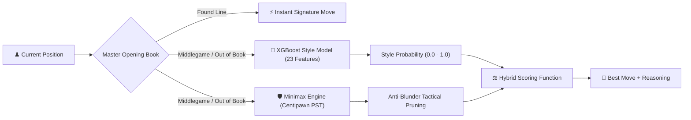

<div align="center">

# ♟️ VICKY AI CHESS
### *Personalized Master AI Opponent • Trained on Real Tournament Games*

[](https://fastapi.tiangolo.com)
[](https://react.dev)
[](https://www.typescriptlang.org)
[](https://tailwindcss.com)
[](https://xgboost.readthedocs.io)
[](https://www.mongodb.com)
[](https://opensource.org/licenses/MIT)

<p align="center">
  <b>Play against a personalized chess engine that captures a real player's attacking instincts, opening repertoire, and positional preferences — protected by master-level tactical pruning.</b>
</p>

[🎮 Play Live](#-quick-start) • [🧠 AI Architecture](#-the-dual-brain-ai-architecture) • [🏆 Leaderboard](#-official-leaderboard) • [🎬 Interactive Replay](#-interactive-game-replayer) • [📡 API Reference](#-rest-api-documentation)

---

</div>

## 📌 Table of Contents
- [✨ Key Highlights](#-key-highlights)
- [🧠 The Dual-Brain AI Architecture](#-the-dual-brain-ai-architecture)
- [📊 Model Performance & Accuracy](#-model-performance--accuracy)
- [🏆 Official Leaderboard](#-official-leaderboard)
- [🎬 Interactive Game Replayer](#-interactive-game-replayer)
- [🍃 Database Architecture (Dual MongoDB & SQLite)](#-database-architecture)
- [🚀 Quick Start (Run Locally in 2 Minutes)](#-quick-start)
- [📡 REST API Documentation](#-rest-api-documentation)
- [🤝 Contributing & License](#-license)

---

## ✨ Key Highlights

- 🤖 **Personalized Master AI (Vicky AI)**: Learns from 192 high-accuracy tournament games (~2200 Elo playing strength).
- ♟️ **Signature Opening Repertoire**: Instant French Defense (`1. e4 e6 2. d4 d5 3. e5 c5!`), Classical King's Pawn lines, and custom systems.
- 🏆 **Global Real-Time Leaderboard**: Live rankings by Elo, Win Rate, and Form Streaks directly from MongoDB.
- 🎬 **Move-by-Move Interactive Replayer**: Click any match to step through moves, use Auto-Play (`▶️`), and inspect notation sheets with sound effects.
- 🛡️ **Multi-User Isolation**: Independent user registration, separate ongoing boards, and isolated match history for each account.
- 🍃 **Dual-Database Resilience**: Auto-connects to MongoDB Atlas / Local MongoDB, with zero-setup automatic SQLite fallback.

---

## 🧠 The Dual-Brain AI Architecture

Vicky AI combines **Machine Learning style imitation** with **Deep Tactical Minimax Search**:



### The Decision Formula

$$\text{Combined Score} = (1 - w) \times \text{Engine Soundness} + w \times \text{Style Preference} + \text{Soundness Bonus}$$

- **Personalization Weight ($w = 0.65$)**: 65% human attacking flair, 35% engine precision.
- **Anti-Blunder Filter**: Automatically eliminates any move that loses $\ge 40$ centipawns or places pieces on undefended attacked squares.

<details>
<summary><b>🔍 Click to Expand: The 23 Extracted Chess Features & Importance</b></summary>

| Feature Name | Importance | Description |
| :--- | :---: | :--- |
| **`is_capture`** | `34.2%` | Aggressive captures and material trades |
| **`is_defended`** | `13.7%` | Destination square safety (protected by friendly piece) |
| **`is_queen`** | `5.4%` | Tactical queen activity and pressure |
| **`is_extended_center`** | `4.5%` | Control of outer central squares (`c3` to `f6`) |
| **`gives_check`** | `4.1%` | Forcing checks against the enemy king |
| **`is_pawn`** | `4.0%` | Pawn chains, structure, and pawn breaks |
| **`is_opening` / `is_dev_move`**| `3.0%` | Minor piece development ($N$ and $B$) |
| **`is_castle`** | `2.8%` | Kingside / Queenside castling timing |
| **`attacks_queen`** | `2.1%` | Tempo-gaining moves attacking opponent's queen |
| **`material_balance`** | `1.2%` | Centipawn balance relative to opposing army |

</details>

---

## 📊 Model Performance & Accuracy

Trained on **37,848 sampled board positions** from **192 peak high-accuracy tournament games** and validated against **89 unseen matches (70,213 test positions)**:

```
┌───────────────────────────────────────┬────────────┐
│ Metric                                │ Result     │
├───────────────────────────────────────┼────────────┤
│ 🎯 Validation AUC                     │ 0.7642     │
│ 🥇 Top-1 Exact Move Accuracy          │ 26.31%     │
│ 🥉 Top-3 Move Prediction Accuracy     │ 48.73%     │
│ 📈 Model Recall (Winning Moves)       │ 82.84%     │
│ ⚔️ Tactical Elo Rating                │ ~2200 Elo  │
└───────────────────────────────────────┴────────────┘
```

---

## 🏆 Official Leaderboard

The leaderboard syncs live player ratings from **MongoDB**:

- **Top 3 Podium**: Crown 👑 (Gold), 🥈 (Silver), 🥉 (Bronze).
- **Player Stats**: Current Elo, Win Rate bar, Record (`W-L-D`), Total Matches, and Recent Form streak (e.g. `[W] [W] [L]`).
- **Benchmark Bot**: Vicky AI Master Bot (2200 Elo) pinned as the gold standard.
- **Search & Filters**: Search players by username, sort by *Top Elo*, *Win Rate*, or *Most Games*.

---

## 🎬 Interactive Game Replayer

Review every match you or any community player has played against Vicky AI:

```
┌────────────────────────────────────────────────────────┐
│  [ |◀ First ]  [ ◀ Prev ]  [ ▶ AUTO REPLAY ]  [ Next ▶ ] │
└────────────────────────────────────────────────────────┘
```

- **Auto-Play Mode**: Sit back and watch moves execute automatically at `1x`, `1.5x`, or `2x` speed.
- **Sound Effects**: Move clicks and capture sound effects powered by Web Audio API.
- **Square Highlights**: Highlights origin and destination squares of the current move.
- **Interactive Score Sheet**: Click **any move** in the two-column notation table (`1. e4 e5`) to jump the board immediately to that position.
- **Keyboard Shortcuts**:
  - `⬅️ Left Arrow` : Step back
  - `➡️ Right Arrow`: Step forward
  - `⎵ Spacebar`   : Play / Pause Auto-Replay
  - `📥 Export`     : Download full match PGN file anytime

---

## 🍃 Database Architecture

Vicky AI uses a **Dual-Adapter Pattern** ([`backend/db_service.py`](backend/db_service.py)):

<details>
<summary><b>📂 Click to View MongoDB Collections Schema</b></summary>

### 1. `users` Collection
```json
{
  "username": "ned04",
  "name": "Ned04",
  "rating": 1500,
  "avatar": "🦁",
  "title": "Challenger",
  "createdAt": 1793785550.67
}
```

### 2. `matches` Collection
```json
{
  "id": "match_1793786475",
  "username": "ned04",
  "white": "Ned04",
  "black": "Vicky AI",
  "result": "1-0",
  "outcome": "win",
  "moveCount": 28,
  "opening": "French Defense: Advance",
  "sanHistory": ["e4", "e6", "d4", "d5", "e5", "c5"],
  "finalFen": "r1bqkbnr/pp1p1ppp/2n1p3/2p1P3/3P4/5N2/PPP2PPP/RNBQKB1R w KQkq - 1 4"
}
```

### 3. `active_games` Collection
Stores unfinished games so players can leave and resume later with their exact clocks and board states.

</details>

---

## 🚀 Quick Start

### Prerequisites
- **Python 3.10+**
- **Node.js 18+** & npm
- *(Optional)* **MongoDB** (Local or [MongoDB Atlas Cloud](https://www.mongodb.com/cloud/atlas))

### Step 1: Clone the Repository
```bash
git clone https://github.com/viknesh74/chess-ai.git
cd chess-ai
```

### Step 2: Setup & Run Backend (FastAPI)
```powershell
# Create and activate virtual environment
python -m venv .venv
.\.venv\Scripts\activate

# Install dependencies
pip install fastapi uvicorn xgboost scikit-learn pandas numpy python-chess pymongo python-dotenv

# Run the FastAPI server
python backend/run_server.py
```
*Backend runs on: `http://127.0.0.1:8000`*

### Step 3: Setup & Run Frontend (React + Vite)
```powershell
cd frontend
npm install
npm run dev
```
*Frontend runs on: `http://127.0.0.1:5173`*

---

## 📡 REST API Documentation

<details>
<summary><b>🔌 Click to View Backend Endpoints</b></summary>

| Method | Endpoint | Description |
| :--- | :--- | :--- |
| `POST` | `/api/vicky/move` | Request Vicky AI to calculate next move |
| `GET` | `/api/db/status` | Live database health status (MongoDB / SQLite) |
| `POST` | `/api/db/register` | Register a new player profile |
| `POST` | `/api/db/login` | Authenticate player username |
| `GET` | `/api/db/users` | List all registered players |
| `GET` | `/api/db/leaderboard` | Get live rankings, Elo, and win rates |
| `GET` | `/api/db/matches` | Fetch all recent community matches |
| `GET` | `/api/db/matches/{username}` | Fetch match history for a specific player |
| `POST` | `/api/db/matches` | Save a completed chess match |
| `DELETE`| `/api/db/matches/{match_id}` | Delete a match record |

</details>

---

## 📄 License

Distributed under the **MIT License**. See `LICENSE` for more information.

---

<div align="center">
  <b>Built with ❤️ by <a href="https://github.com/viknesh74">viknesh74</a></b><br>
  <i>Challenging human players with the mind of a Master AI.</i>
</div>
